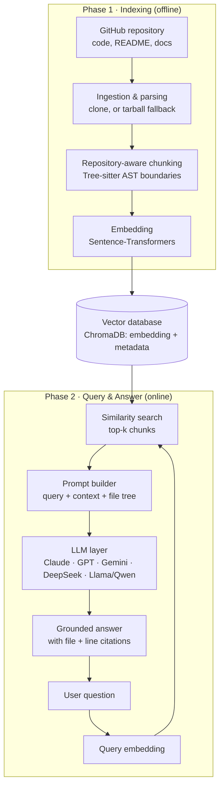

# 🧠 GitNeuron

**Chat with any GitHub repository, in plain English.**

GitNeuron is an AI-powered assistant that lets developers explore and understand unfamiliar codebases through natural-language conversation. It indexes a repository's code and documentation with **repository-aware chunking** and **semantic search**, then uses **Retrieval-Augmented Generation (RAG)** to ground every answer in the real source — with cited files and line numbers, not guesses.

> Project ID `2026MCSEAIA14` · B.Tech CSE (AI), ABES Institute of Technology, Ghaziabad · Affiliated to AKTU, Lucknow

[](./LICENSE)
[](./backend)
[](./backend)
[](./frontend)
[](#model-agnostic-llm-layer)

---

## Table of Contents

- [Why GitNeuron](#why-gitneuron)
- [Key Features](#key-features)
- [How It Works](#how-it-works)
- [Tech Stack](#tech-stack)
- [Project Structure](#project-structure)
- [Getting Started](#getting-started)
- [Using GitNeuron](#using-gitneuron)
- [Configuration Reference](#configuration-reference)
- [Evaluation Plan](#evaluation-plan)
- [Roadmap / Future Scope](#roadmap--future-scope)
- [Sustainable Development Goals](#sustainable-development-goals)
- [Scope & Honesty Notes](#scope--honesty-notes)
- [References](#references)
- [Team](#team)
- [License](#license)

---

## Why GitNeuron

Every developer — a new hire, an open-source contributor, a reviewer, a student — eventually has to work inside a codebase they didn't write. That process is usually painfully slow:

| Problem | Why it hurts |
|---|---|
| 🕒 **Slow onboarding** | Developers spend hours (or days) manually opening files and tracing calls to build a mental model of a repo. |
| 📄 **Outdated docs** | READMEs and wikis drift out of sync with the code and are often missing exactly where you need them most. |
| ❓ **No natural way to ask** | There's no way to just *ask* a repository a question — you read through it by hand. |
| 🤖 **Generic AI tools fall short** | A plain LLM doesn't know your repo and can hallucinate; generic document-style RAG tools break down on large, multi-file codebases. |

**GitNeuron's answer:** point it at any GitHub repository, let it build a semantic index of the code, and chat with it the way you'd talk to a teammate who already knows the project.

## Key Features

- 💬 **Natural-language chat** over any public (or token-authorized private) GitHub repository
- 🎯 **RAG-grounded answers** with exact file + line citations — reduces hallucination
- 🧩 **Repository-aware chunking** using Tree-sitter AST boundaries (falls back gracefully for unsupported languages), so functions and classes aren't sliced in half
- 🔍 **Semantic code search** via vector embeddings — ask "where is login handled?" even if no file is named `login`
- 🗂️ **File-structure awareness** — the repo's file tree is captured at index time, browsable in the UI, and injected into prompts for structural questions
- 🔀 **Model-agnostic LLM layer** — Claude, GPT, Gemini, DeepSeek, Llama/Qwen (via Groq), selectable or left on an automatic fallback chain
- 🧠 **Live agent reasoning canvas** — watch the plan → embed → retrieve → generate pipeline unfold in real time over a streaming connection
- 🛡️ **Autonomous error recovery** — in-provider retries, then automatic fallback across the configured model chain; repo cloning falls back from `git clone` to a GitHub tarball download if needed
- 📤 **One-click export** — push an answer to a GitHub Gist, a citation-included PDF, or a live CodeSandbox
- 🧰 **System-prompt template library** — Onboarding, Code Review, Debugging, Docs, and Architecture modes that genuinely change how the agent answers
- 📊 **Generative UI** — Architecture-mode answers can render inline Mermaid diagrams
- 🎙️ **Voice input** — browser speech-to-text in the chat composer, where supported
- 🪪 **Open source**, released under Apache-2.0

## How It Works

GitNeuron runs in two phases: an **offline indexing phase** and an **online query-and-answer phase**.



**Pipeline in short:**

1. **Repository ingestion** — fetch and parse source code, README, and docs (`git clone`, with an HTTPS tarball fallback if cloning fails).
2. **Chunking & embedding** — split files along code structure (functions, classes) rather than fixed-size windows, and convert each chunk to a vector embedding.
3. **Vector storage** — persist embeddings with metadata (file path, language, line range) in ChromaDB.
4. **Retrieval** — embed the user's question and run a similarity search for the top-k relevant chunks.
5. **Generation** — build a prompt from the question, retrieved context, and a condensed file tree, then send it through the configured LLM provider chain.
6. **Streaming & recovery** — each pipeline step streams live to the UI as a reasoning trace; failed LLM or retrieval calls retry and fall back automatically.

## Tech Stack

| Layer | Technology | Purpose |
|---|---|---|
| Backend language | Python 3 | Core indexing & RAG pipeline |
| Frontend language | TypeScript / React | Chat UI, reasoning canvas, file explorer |
| Repository access | GitHub REST API · GitPython | Fetch source files, README, documentation |
| Parsing & chunking | `tree-sitter`, `tree-sitter-languages` | Structure-aware splitting of code and docs |
| Embeddings | `sentence-transformers` (local, swappable) | Convert chunks and queries into vectors |
| Vector database | ChromaDB | Store embeddings + metadata, run similarity search |
| LLM layer | Anthropic, OpenAI, Google Gemini, DeepSeek, Groq (Llama/Qwen) SDKs | Generate grounded answers |
| Backend API | FastAPI + Uvicorn | REST + Server-Sent Events endpoints |
| Frontend tooling | Vite, `react-markdown`, `mermaid` | Chat interface, markdown & diagram rendering |
| Export | GitHub Gists API, `fpdf2`, CodeSandbox | One-click artifact export |
| License | Apache-2.0 | Open, forkable, commercial-friendly |

Each layer is decoupled, so any one of them (embedding model, vector store, LLM provider) can be swapped without rebuilding the rest of the system.

## Project Structure

```
gitneuron/
├── backend/
│   ├── app/
│   │   ├── main.py                  FastAPI app + route registration
│   │   ├── config.py                Settings (env-driven, model-agnostic)
│   │   ├── models.py                Pydantic schemas
│   │   ├── core/
│   │   │   ├── github_service.py    Validate, clone, tarball-fallback, walk, file tree
│   │   │   ├── chunking.py          Repository-aware (tree-sitter) chunking
│   │   │   ├── embeddings.py        Sentence-Transformers embedding wrapper
│   │   │   ├── vectorstore.py       ChromaDB persistence + query
│   │   │   ├── indexing.py          Background indexing pipeline + status + file tree cache
│   │   │   ├── rag.py               Retrieval + generation + live reasoning stream
│   │   │   ├── templates.py         System-prompt template library
│   │   │   ├── model_catalog.py     Curated provider/model list + configured-key flags
│   │   │   └── export.py            Gist / PDF / CodeSandbox export
│   │   ├── providers/
│   │   │   ├── base.py              LLMProvider interface
│   │   │   └── adapters.py          Anthropic / OpenAI / Gemini / DeepSeek / Groq adapters
│   │   └── routes/
│   │       ├── repos.py             POST /api/repos, GET .../status, GET .../files
│   │       ├── chat.py              POST /api/chat, POST /api/chat/stream (SSE)
│   │       ├── templates.py         GET /api/templates
│   │       ├── model_catalog.py     GET /api/models
│   │       └── export.py            POST /api/export/{gist,pdf,sandbox}
│   ├── requirements.txt
│   └── .env.example
└── frontend/
    ├── src/
    │   ├── App.tsx                  Top-level state: indexing, chat, model/template selection
    │   ├── components/
    │   │   ├── RepoBar.tsx           Repo URL input + live index status
    │   │   ├── FileTree.tsx         Collapsible repo file-structure explorer
    │   │   ├── ChatPanel.tsx        Message list, composer, voice input
    │   │   ├── ModelSelector.tsx    Provider/model picker (reflects configured keys)
    │   │   ├── TemplateSelector.tsx System-prompt template picker
    │   │   ├── MessageBubble.tsx    Renders one turn (markdown + Mermaid + extras)
    │   │   ├── MermaidBlock.tsx     Inline architecture-diagram rendering
    │   │   ├── ReasoningTrace.tsx   Live-streaming reasoning node graph
    │   │   ├── SourcesPanel.tsx     Cited file/line snippets
    │   │   └── ExportMenu.tsx       Gist / PDF / CodeSandbox export
    │   ├── lib/{api.ts,types.ts}
    │   └── styles/global.css        Hand-built minimal design system
    ├── index.html
    ├── package.json
    └── vite.config.ts
```

## Getting Started

### Prerequisites

- Python 3.10+
- Node.js 18+
- At least one LLM provider API key (Anthropic, OpenAI, Gemini, DeepSeek, or Groq)

### 1. Backend

```bash
cd backend
python3 -m venv .venv
source .venv/bin/activate        # Windows: .venv\Scripts\activate
pip install -r requirements.txt

cp .env.example .env
# edit .env and set at least ONE provider key, e.g.:
#   ANTHROPIC_API_KEY=sk-ant-...
# optionally GITHUB_TOKEN for private repos / higher rate limits

uvicorn app.main:app --reload --port 8000
```

The first run downloads the local embedding model (`sentence-transformers/all-MiniLM-L6-v2`, ~90MB) — no API key is needed for embeddings, file-tree capture, or chunking.

### 2. Frontend

```bash
cd frontend
npm install
npm run dev
```

Open the printed URL (default `http://localhost:5173`). The dev server proxies `/api` to `http://localhost:8000`, so **both must be running**.

## Using GitNeuron

1. Paste a `github.com` repository URL (e.g. `https://github.com/pallets/flask`) and click **Index repository**. Watch it move through *validating → cloning → chunking → embedding*.
2. Once **Ready**, open **File structure** to browse what was indexed.
3. Pick a **template** (Onboarding, Code Review, Debugging, Docs, Architecture) and, optionally, a specific **model** — leave it on "Auto" to use the configured fallback chain.
4. Ask a question. The reasoning canvas fills in live (plan → embed → search → generate, with any retry/fallback shown) while the answer streams in; the finished answer shows its exact file + line sources.
5. Use **Export** on any answer to push it to a GitHub Gist, download it as a PDF with citations, or open it in CodeSandbox.

## Configuration Reference

Set these in `backend/.env` (see `backend/.env.example`):

| Variable | Purpose |
|---|---|
| `ANTHROPIC_API_KEY` / `OPENAI_API_KEY` / `GEMINI_API_KEY` / `DEEPSEEK_API_KEY` / `GROQ_API_KEY` | At least one, for generation — also controls which models `GET /api/models` marks as usable |
| `GITHUB_TOKEN` | Optional — private repos, higher clone/API rate limits, and the tarball-fallback path |
| `GITHUB_GIST_TOKEN` | Optional — defaults to `GITHUB_TOKEN`; needs `gist` scope |
| `EMBEDDING_MODEL` | Any Sentence-Transformers model name |
| `LLM_CHAIN` | Ordered `provider:model` fallback list, e.g. `anthropic:claude-sonnet-4-5,openai:gpt-4o-mini` |
| `TOP_K` | Chunks retrieved per question (default `8`) |
| `MAX_CHUNK_TOKENS` | Target chunk size (default `400`) |

## Evaluation Plan

GitNeuron is evaluated on open-source repositories of varying size and language, along four axes:

- **Retrieval quality** — top-k hit rate against known-relevant code
- **Answer quality** — correctness and groundedness against the actual source
- **Response time** — indexing latency and per-query latency
- **User trial** — time-to-answer with GitNeuron vs. manual exploration, on a small sample of developers

## Roadmap / Future Scope

- [ ] Incremental re-indexing on new commits, so answers stay current
- [ ] First-class support for private repositories with secure authentication
- [ ] Structure-aware retrieval using call/dependency graphs, plus hybrid keyword + vector search with re-ranking
- [ ] Multi-repository question answering and cross-project comparison
- [ ] IDE integration (VS Code) and pull-request / code-review workflows
- [ ] Automatic documentation generation and syncing from the codebase
- [ ] Richer voice interfaces and generative UI
- [ ] Support for locally hosted open models for organizations with strict data-privacy requirements

## Sustainable Development Goals

| SDG | Contribution |
|---|---|
| 🎓 **SDG 4 — Quality Education** | Helps students and new developers learn faster from real, complex codebases |
| 💼 **SDG 8 — Decent Work & Economic Growth** | Improves developer productivity and lowers onboarding costs for organizations |
| 🏗️ **SDG 9 — Industry, Innovation & Infrastructure** | Encourages innovation in AI-assisted software development tooling |

## Scope & Honesty Notes

This is a working reference implementation, built to run locally without infrastructure beyond Python + Node. Every feature described above is implemented end-to-end (backend → API → UI), with two things scoped honestly rather than inflated:

- **Template library** — a handful of templates that each genuinely change agent behavior, rather than a large but shallow set of copy-pasted prompts.
- **Live reasoning canvas** — a real-time step graph of what the agent is actually doing as it happens, not a fabricated "thoughts" narration.

Items under [Roadmap / Future Scope](#roadmap--future-scope) are intentionally left as extension points rather than stubbed-out UI.

## References

1. Lewis, P. et al. (2020). *Retrieval-Augmented Generation for Knowledge-Intensive NLP Tasks.*
2. Wang, Z. Z. et al. (2025). *CodeRAG-Bench: Can Retrieval Augment Code Generation?* Findings of ACL: NAACL 2025.
3. Wu, D. et al. (2024). *Repoformer: Selective Retrieval for Repository-Level Code Completion.* ICML 2024.
4. Gao, Y. et al. (2024). *Retrieval-Augmented Generation for Large Language Models: A Survey.* arXiv:2312.10997.
5. Zhang, F. et al. (2023). *RepoCoder: Repository-Level Code Completion Through Iterative Retrieval and Generation.* EMNLP 2023.
6. Ding, Y. et al. (2023). *CrossCodeEval: A Diverse and Multilingual Benchmark for Cross-File Code Completion.* NeurIPS 2023.
7. Lu, S. et al. (2022). *ReACC: A Retrieval-Augmented Code Completion Framework.* ACL 2022.
8. Shrivastava, D. et al. (2022). *Repository-Level Prompt Generation for Large Language Models of Code.* arXiv:2206.12839.
9. Guo, D. et al. (2022). *UniXcoder: Unified Cross-Modal Pre-training for Code Representation.* ACL 2022.
10. Parvez, M. R. et al. (2021). *Retrieval Augmented Code Generation and Summarization (REDCODER).* Findings of EMNLP 2021.
11. Guo, D. et al. (2021). *GraphCodeBERT: Pre-training Code Representations with Data Flow.* ICLR 2021.

## Team

Developed by students of **Computer Science & Engineering (AI)**, ABES Institute of Technology, Ghaziabad, under the supervision of **Ms. Neeti Saxena**, Assistant Professor, Dept. of CSE-AI.

| Name | Roll No. |
|---|---|
| Ansh Raj Saxena | 2502901520059 |
| Anshika Baghel | 2502901520064 |
| Anshika Jangid | 2502901520065 |
| Arjun Pratap Banerji | 2502901520072 |

## License

Released under the **[Apache License 2.0](./LICENSE)** — free to use, fork, modify, and commercialize.

---

<p align="center"><i>GitNeuron — turning "I found an interesting repository" into "I understand it" in a single conversation.</i></p>
